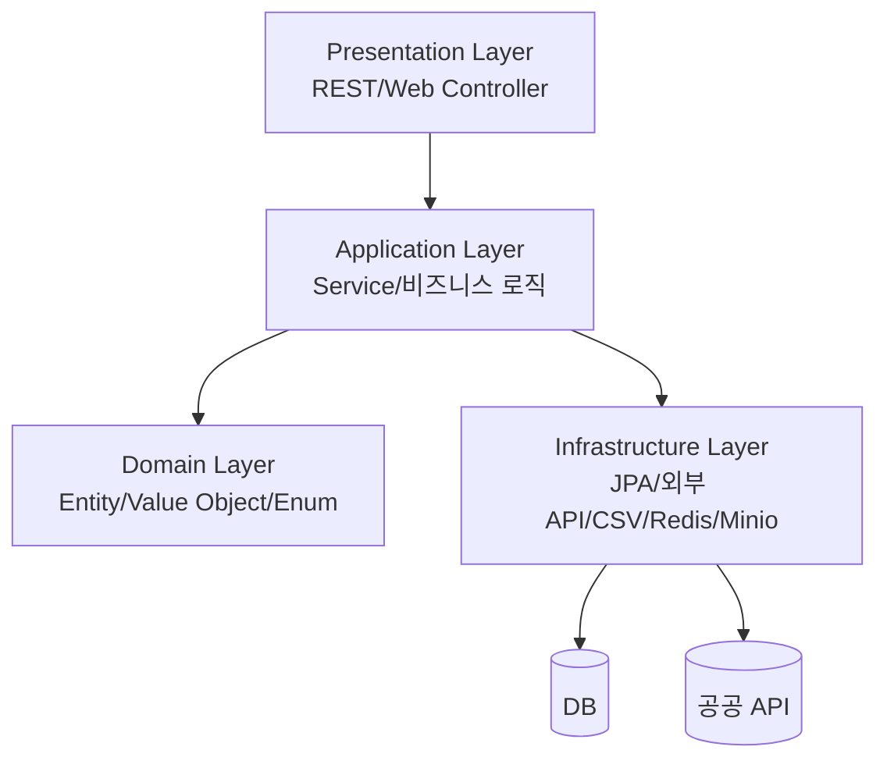

<br/>

# Public Data Harvester (통신판매 사업자 정보 관리 시스템)

## 프로젝트 소개

**Public Data Harvester**는 시/도(city), 구/군(district) 정보를 입력받아,
공공 데이터(CSV)와 외부 API(법인등록번호, 행정구역코드)를 활용해
통신판매 사업자 정보를 수집·가공·저장하는 백엔드 시스템입니다.

- **법인 정보 관리**: 법인 등록, 수정, 삭제, 검색
- **회원 관리**: 회원가입, 로그인, 권한 관리
- **파일 관리**: 파일 업로드/다운로드, MinIO/Local 저장소 지원
- **CSV 배치 처리**: 대량 데이터 처리 및 내보내기
- **대시보드**: 지역별 통계 및 성능 모니터링
- **캐시 관리**: Redis/Memory 기반 캐시 시스템
- **보안**: JWT 기반 인증, Rate Limiting

---

## 아키텍처

### 1. ** 아키텍처**



- **Presentation**: REST API, Web Controller, 관리자/사용자 인터페이스
- **Application**: 비즈니스 서비스, 트랜잭션, 비동기/병렬 처리
- **Domain**: 핵심 도메인 모델, 엔티티, 값 객체, Enum
- **Infrastructure**: JPA 저장소, 외부 API 클라이언트, 파일/캐시/레이트리밋 등

### 2. **주요 기술 스택**

- Spring Boot 3.x, Spring Data JPA, Spring Security, Actuator
- H2/PostgreSQL, Redis (환경별 선택)
- CompletableFuture, @Async (비동기)
- Minio (파일), OpenAPI(Swagger)
- Lombok, Jasypt(암호화), Testcontainers(테스트)

---

## 주요 기능

- **CSV 데이터 필터링 및 저장**: 시/도, 구/군별 CSV에서 법인 데이터만 추출, DB 저장
- **공공 API 연동**: 법인등록번호, 행정구역코드 실시간 조회 및 병합
- **비동기 병렬 처리**: 대량 데이터도 빠르게 처리 (CompletableFuture)
- **운영/관리**: 캐시/레이트리밋/헬스체크/모니터링 API 제공
- **환경별 설정**: dev(로컬+Redis+Minio), prod(H2+로컬파일) 등 profile별 분리

---

## 폴더 구조

```
src/
└── main/
    ├── java/
    │   └── com/antock/
    │       ├── api/
    │       │   ├── coseller/   # 통신판매 사업자 도메인
    │       │   ├── member/     # 회원 도메인
    │       │   ├── admin/      # 관리자 및 운영 기능
    │       │   ├── global/     # 공통/유틸/설정
    │       │   └── web/        # Web Controller (JSP 기반)
    └── resources/
        ├── application.yml
        ├── application-dev.yml
        └── application-prod.yml
```

---

## 장점 및 차별점

- **설정 기반 유연성**: API/DB/캐시/파일 등 환경별 손쉬운 전환
- **비동기 병렬 처리**: 대량 데이터도 빠르고 안정적으로 처리
- **운영/관리 편의성**: 헬스체크, 캐시/레이트리밋 모니터링, 관리자 API 내장
- **테스트/보안/암호화**: Testcontainers, Spring Security, Jasypt 등 적용

---

## 추후 예정

- WebClient + Reactor 기반 리액티브 병렬 처리로 확장 가능
- AOP 기반 공통 로깅 추가 시 운영/디버깅 편의성 향상
- 엔티티-DTO 변환 Mapper/Assembler 패턴 적용 시 유지보수성 강화
- 대용량 CSV/에러처리 Robustness, 테스트 커버리지 추가

---

## 실행 방법

```bash
# 운영 환경 (dev, Redis/Minio 사용)
./gradlew runDev

# 개발 환경 (prod, H2/로컬파일 사용)
./gradlew runProd
```

### API 테스트

```bash
# Swagger UI를 통한 테스트
# 또는 Postman Collection 사용
```

## 성능 최적화

### 캐싱 전략

- Redis 기반 분산 캐시
- Local Memory 캐시
- Cache Eviction 정책

Redis가 끊기면 서버마다 메모리 캐시와 요청 횟수를 따로 둔다.
장애 중 일관성보다 가용성 선택. 메모리 항목은 1~5분 안에 만료된다.
`RedisHealthIndicator`가 DOWN에서 UP으로 바뀌면 메모리 캐시를 비우고 Redis로 되돌린다.

### 배치 처리

- Chunk 기반 처리
- 비동기 실행
- 재시도 메커니즘

### 데이터베이스 최적화

- 인덱스 최적화
- N+1 쿼리 방지
- Connection Pool 설정

법인 목록에서 이력까지 읽을 때의 JDBC 문 개수. `@BatchSize(100)` 적용 후를 같은 코드로 측정했다.

| 법인 수         | 개선 전 | 개선 후 |
| --------------- | ------: | ------: |
| 2,000건         | 2,001회 |    21회 |
| 900건 (현재 DB) |   901회 |    10회 |


## 문제 해결

### 일반적인 문제

1. **Redis 연결 실패**: Memory 캐시로 자동 Fallback. 장애 중 일관성보다 가용성 선택. 복구 후 메모리 캐시는 비운다.
2. **파일 업로드 실패**: 저장소 설정 확인
3. **JWT 토큰 만료**: Refresh Token 사용

### 로그 확인

```bash
# 애플리케이션 로그
tail -f logs/application.log

# 에러 로그
tail -f logs/error.log
```

## 지원

- **개발팀**: sleekydz86@naver.com
- **문서**: [API Documentation](http://localhost:8080/swagger-ui.html)
- **이슈**: GitHub Issues

## 트러블슈팅

- [Spring Security 테스트에서 커스텀 사용자 인증 객체 주입 문제 해결](https://velog.io/@sleekydevzero86/spring-security-test-with-custom-user)
- [대규모 더미 데이터 생성 시 N+1 문제 해결](https://velog.io/@sleekydevzero86/jpa-n-plus-1-solution)
